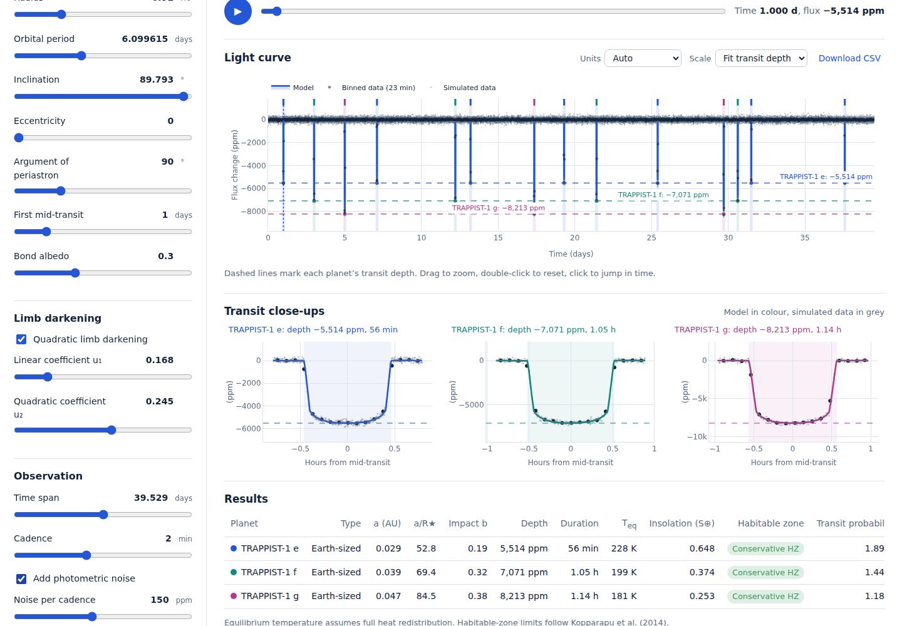
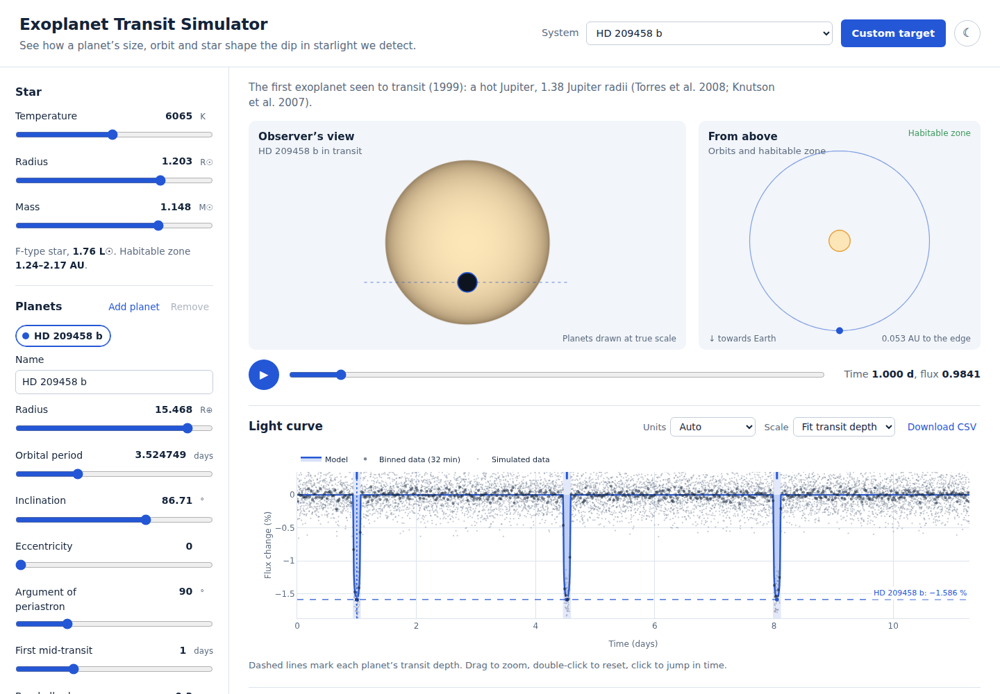

# 🪐 Exoplanet Transit Simulator


**[Open the live simulator →](https://jiqbal-astro.github.io/exoplanet-transit-simulator/)**

An interactive, in-browser simulator of exoplanet transits. Drag a slider and you see right away how a planet’s size, orbit and host star change the dip in starlight we detect. Five views stay linked: the star as seen from Earth, the orbits from above with the habitable zone, the full light curve, a close-up of each transit, and a table of derived properties.



## What you can do

- **Load real systems:** TRAPPIST-1 e, f and g together, the hot Jupiter HD 209458 b, Kepler-186 f, Kepler-22 b, Earth seen from afar, and a hypothetical transit of Proxima b.
- **Change anything live:** star temperature, radius and mass; planet radius, period, inclination, eccentricity, argument of periastron, mid-transit time and albedo. You can add up to four planets. Every slider also has a number box where you can type an exact value, including values beyond the slider's range.
- **Model your own target:** **Custom target** opens a form for your star and up to four planets. Give a planet's size as a radius (R⊕ or R♃) *or* as a measured transit depth, and its orbit as an inclination *or* an impact parameter. Targets you create are saved under *My targets* in the system list.
- **Watch it move:** press play (or the space bar) and the planets cross the star while a cursor runs along the light curve. Click anywhere on the light curve to jump to that moment.
- **See every transit clearly:** the light curve scales to the transit depth by default. Each transit is shaded, marked at its deepest point, and drawn against a dashed line labelled with its depth. You can switch units between ppm, % and relative flux, and the scale between *fit transit depth* and *fit all data*.
- **Test detectability:** add photometric noise at any cadence and level to see whether a transit is detectable. Binned data show the dip coming out of the noise, and the expected signal-to-noise ratio is reported.
- **Read the results:** semi-major axis, a/R★, impact parameter, depth, duration, equilibrium temperature, insolation, habitable-zone status, transit probability and SNR.
- **Export** the light curve as CSV, and any plot as PNG from its toolbar.



## Physics

| | Method |
|---|---|
| Orbits | Kepler’s equation solved by Newton iteration; semi-major axis from Kepler’s third law |
| Sky geometry | Winn (2010): only the planet *in front of* the star (Z > 0) blocks light, so there is one dip per orbit |
| Transit shape | Exact overlap area of two circles (sharp ingress and egress) with quadratic limb darkening in the small-planet approximation of Mandel & Agol (2002) |
| Duration, impact parameter, probability | Winn (2010), including eccentricity |
| Habitable zone | Kopparapu et al. (2014): conservative (runaway → maximum greenhouse) and optimistic (recent Venus → early Mars) |
| Equilibrium temperature | Full heat redistribution, Bond albedo A |
| Detectability | SNR = depth/σ × √(number of in-transit points) |

The physics tests check the model against known values: Earth’s 84 ppm, 13-hour transit and its 255 K equilibrium temperature, the solar habitable zone (0.95–1.68 AU), and HD 209458 b’s 1.4% depth.

## Run it locally

No installation or build is needed. Clone the repository and open `index.html` in a browser:

```bash
git clone https://github.com/Jiqbal-astro/exoplanet-transit-simulator.git
cd exoplanet-transit-simulator
open index.html          # macOS; or double-click the file
```

To model your own system, use **Custom target** in the app, or add a permanent preset to `js/data.js`.

## Tests

```bash
node --test                        # 14 physics tests
npm install && pip install playwright && python -m playwright install chromium
python tests/test_browser.py       # 67 end-to-end checks in a real browser
```

The browser test loads every preset, moves every slider and types exact values. It creates custom targets in every input mode (Earth or Jupiter radii, transit depth, inclination or impact parameter) and rejects invalid input. It also checks that the transit depth fills the light-curve plot, toggles every switch, unit and scale, plays and pauses, scrubs, clicks and zooms the light curve, adds and removes planets, downloads the CSV and switches theme, and fails on any JavaScript error. GitHub Actions runs both suites on every push.

## Project structure

```
├── index.html
├── css/style.css
├── js/
│   ├── physics.js     # transit physics (no DOM; also runs in Node)
│   ├── data.js        # planet presets with sources
│   └── app.js         # interface
├── tests/             # physics tests (Node) and browser tests (Playwright)
├── tools/             # test harness and screenshot script
└── docs/              # screenshots
```

## Limitations

The model treats the star as a smooth limb-darkened disk with no spots, flares or granulation, and the noise is white. Planets are opaque disks with no atmosphere, rings or thermal emission, and the occultation (secondary eclipse) is not modelled. The small-planet limb-darkening approximation is very accurate for rocky planets and good to a few per cent for giant planets.

## References

- Winn, J. N. (2010), *Transits and Occultations*, in *Exoplanets*, ed. S. Seager, arXiv:1001.2010
- Mandel, K. & Agol, E. (2002), ApJ, 580, L171
- Kopparapu, R. K. et al. (2014), ApJL, 787, L29
- Agol, E. et al. (2021), PSJ, 2, 1; Ducrot, E. et al. (2020), A&A, 640, A112 (TRAPPIST-1)
- Torres, G., Winn, J. N. & Holman, M. J. (2008), ApJ, 677, 1324; Knutson, H. A. et al. (2007), ApJ, 655, 564 (HD 209458 b)
- Quintana, E. V. et al. (2014), Science, 344, 277 (Kepler-186 f)
- Borucki, W. J. et al. (2012), ApJ, 745, 120 (Kepler-22 b)
- Anglada-Escudé, G. et al. (2016), Nature, 536, 437 (Proxima b)

## Author

**Javed Iqbal**: astronomy researcher working on exoplanets and variable stars
[GitHub](https://github.com/Jiqbal-astro) · [Website](https://jiqbal-astro.github.io) · [LinkedIn](https://www.linkedin.com/in/jiqbal-astro/)

Released under the [MIT License](LICENSE).
